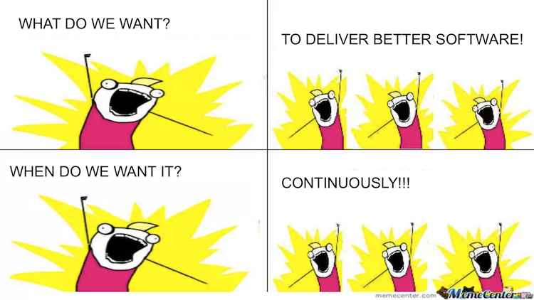
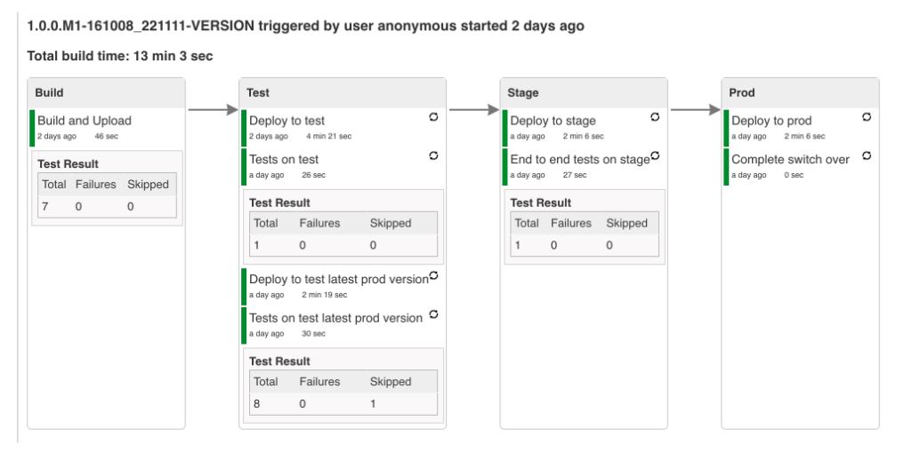

<h1>
  Continuous Integration and Delivery
  Continuous Delivery
</h1>

**Learning objective:** By the end of this lesson, students will be able to analyze the role of continuous delivery in streamlining deployment workflow and distinguish it from continuous deployment.

## Continuous delivery

Continuous delivery (CD) is an approach that builds on continuous integration. CD ensures that our code is always in a deployable state, even with thousands of developers making changes regularly. Teams produce software in short cycles so they can release the software whenever necessary. CD helps teams save time and money and makes delivering changes less risky.

 

 

## Development, staging, and production environments

In most enterprises, there are several different environments where a new version of the application (a release candidate) needs to be built, tested, and/or reviewed before deployment to the production environment.

| **Stage** | **Description**                                                                                                                                                                                                                     |
| --------- | ----------------------------------------------------------------------------------------------------------------------------------------------------------------------------------------------------------------------------------- |
| **Build** | Code is compiled, and application artifacts (ex: `.rpm`, `.war` file, or `image`) are constructed. Sometimes, unit tests are also run here. Once the artifact is created, it is pushed to a repository and should remain unchanged. |
| **Test**  | The artifact is pulled from the repository and installed in a test environment. This is where integration testing, performance testing, and other types of testing occur.                                                           |
| **Stage** | The staging environment is the final step before promoting the artifact to production. Additional tests (automated or manual) may be run here, and human users can perform acceptance testing to validate the artifact's readiness. |

In CI/CD, this whole process — including deployments from build to test to stage and (optionally) to production — should be automated by your build pipeline.

Here's an example of what that pipeline might look like in Jenkins:

 

 

_[Full Pipeline View](https://github.com/marcingrzejszczak/jenkins-pipeline/blob/master/README.adoc)_

## The other "CD"

In some companies, there will need to be a final approval or review by a human before software can actually be **_deployed_** to production. If that isn't the case, you can also fully automate that final deployment step (a practice known as **continuous deployment**).

- _**Continuous delivery**_ ensures that code can be rapidly and safely deployed to production and that applications function as expected through rigorous automated testing.

- _**Continuous deployment**_ is the next step of continuous delivery: Every change that passes the automated tests is deployed to production automatically.

  <h2 class="title">When is continuous deployment helpful? When might you not want to use continuous deployment?</h2>
  10 min

**Let’s Discuss:**

- What kinds of projects or industries might benefit the most from continuous deployment?
- What challenges could arise when using continuous deployment in a less-than-ideal scenario?
- Can you think of strategies or tools that could address some of these challenges?

| Situations Where Continuous Deployment Is Beneficial                                                                                 | Situations Where Continuous Deployment May Not Be Ideal                                                                        |
| ------------------------------------------------------------------------------------------------------------------------------------ | ------------------------------------------------------------------------------------------------------------------------------ |
| Rapid innovation and frequent updates, such as in consumer-facing apps or services requiring quick iteration based on user feedback. | In highly regulated industries (ex: finance, healthcare) where changes must undergo extensive manual review before deployment. |
| Ensures consistent delivery, minimizes manual errors, and speeds up the feedback loop between developers and end-users.              | When changes have a large, unpredictable impact on end-users, making human oversight and control essential before deployment.  |
| Works well with strong automated testing and robust monitoring systems to quickly catch and address issues.                          | For organizations lacking confidence in their test coverage or monitoring tools, as undetected issues could reach production.  |

## Further reading

- [Continuous Delivery](https://continuousdelivery.com/)
- [An Introduction to Continuous Integration, Delivery, and Deployment](https://www.digitalocean.com/community/tutorials/an-introduction-to-continuous-integration-delivery-and-deployment)
- [Defect Prevention: Reducing Costs and Enhancing Quality](https://www.isixsigma.com/industries/software-it/defect-prevention-reducing-costs-and-enhancing-quality/)
- [Continuous Integration](https://www.martinfowler.com/articles/continuousIntegration.html)
- [Dev Leaders Compare Continuous Delivery vs. Continuous Deployment vs. Continuous Integration](https://stackify.com/continuous-delivery-vs-continuous-deployment-vs-continuous-integration/)
