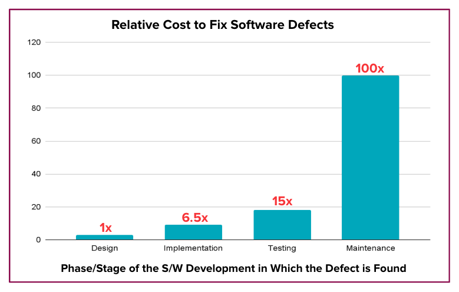
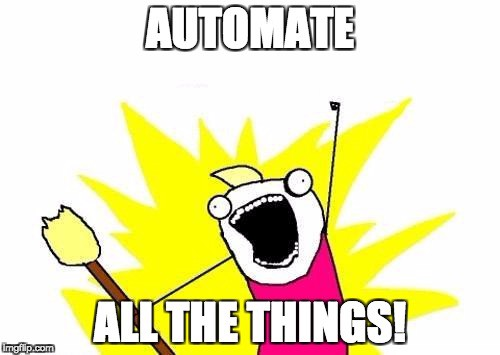

<h1>
  Continuous Integration and Delivery
  Continuous Integration
</h1>

**Learning Objective:** By the end of this lesson, students will be able to explain the purpose of Continuous Integration (CI), describe its key practices, and identify how a build pipeline supports CI.

## Continuous integration

[Avoiding software disasters](https://ga-instruction.s3.amazonaws.com/assets/continuous-integration/CImeme.png) starts with **Continuous Integration (CI)**.

CI is a practice where developers frequently integrate their work into a shared repository—often multiple times a day. Each integration triggers an automated build and testing process, ensuring that bugs are caught early and collaboration stays efficient.

### Commit small changes often

A cornerstone of CI is committing small, incremental changes to the main branch frequently—at least daily. Smaller changes are easier to test and debug, helping teams quickly identify and fix issues when something breaks.

Frequent commits also ensure that everyone on the team works from a single, up-to-date codebase. However, for this workflow to be effective, the build process must be **fast** so developers receive immediate feedback on their changes.

### Why does continuous integration save time and money?

Catching bugs early in the **Software Development Life Cycle (SDLC)** is much less costly than finding bugs later. As bugs progress through the SDLC, the cost to fix them rises dramatically.

 

 

_Relative Costs to Fix Software Defects (Source: [IBM Systems Sciences Institute](https://devops.com/shift-left-can-you-be-left-out/))_

 

  <h2 class="title">Real Case: Samsung Galaxy Note 7</h2>
  2 min

Consider the Samsung Galaxy Note 7 battery issue: a faulty battery management system caused the phones to catch fire! It was a disaster that cost Samsung nearly **$17 billion**. Think about how much could have been avoided if they had caught the issue earlier. With early testing and solid CI practices, they might have saved not only money but also their reputation.

 

 

> **Key takeaway:** CI helps teams find and fix problems when they’re cheaper and easier to address.

## Automate testing with a build pipeline

So, how do we find bugs early? By testing early and often.

Testing early and often is essential for CI. The best way to ensure consistent testing is through automation.

- A **_build pipeline_** automates the process of building, testing, and deploying your application whenever code changes are made.

This reduces manual effort and ensures testing happens consistently.

 

 

## What is a build pipeline?

A build pipeline is a series of automated steps that execute when a change is detected in the codebase.

These steps often include:

- **Building the application**: Compiling or packaging the code into a runnable format.
- **Running automated tests**: Ensuring the code behaves as expected.
- **Other processes**: Linting, security checks, or deploying to a staging environment.

Pipelines are typically organized into **_stages_**, and each stage contains **_steps_**. These steps can run tools like [Maven](https://maven.apache.org/), [Gradle](https://gradle.org/), or custom scripts.

 

  <h2 class="title">Characteristics of a Great Build Pipeline</h2>
  5 min

Let's discuss: What do you think are the main characteristics of an ideal build pipeline?

1. **Fast**: Your build pipeline should provide feedback almost immediately after running tests. Quick feedback allows you to identify and fix issues right away while you're still focused on the feature you're working on.

2. **Repeatable**: The process for building and testing your application should always be the same. It should also run in a consistent build environment. This consistency minimizes variability between builds, making it easier to troubleshoot bugs when they arise.

3. **Reliable**: Your build pipeline and tests should be designed so that failures are caused by actual issues in the application, not by problems in the testing environment or pipeline setup. For example, avoid "false positives" caused by leftover data from previous tests or conflicts over shared resources like files or databases.

By adopting CI practices and a strong build pipeline, teams can work efficiently, reduce errors, and deliver higher-quality software.
