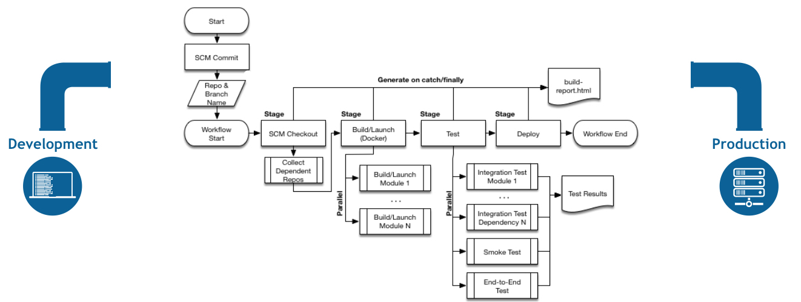

<h1>
  <span class="headline">Continuous Integration and Delivery</span>
  <span class="subhead">Creating a Build Pipeline with Jenkins</span>
</h1>

**Learning objective:** By the end of this lesson, students will be able to explain the purpose and key components of a Jenkins pipeline, including how it automates software build and test processes, and describe how plugins and repositories enhance its functionality.

## Creating a build pipeline with Jenkins

[Jenkins](https://jenkins.io/) is one of the most popular tools for creating CI/CD pipelines It's an open-source automation server that can be used to automate all sorts of tasks related to building, testing, and delivering software.

> Other widely used tools in this space include [GitLab CI](https://docs.gitlab.com/ee/ci/), [Atlassian Bamboo](https://www.atlassian.com/software/bamboo), and [JetBrains TeamCity](https://www.jetbrains.com/teamcity/).

<br>

<div class="activity partner-exercise">
  <h2 class="title">Getting familiar with Jenkins</h2>
  <span class="minutes">15 min</span>
</div>

Let’s start by exploring Jenkins. With a partner, take a look at the [Jenkins documentation](https://jenkins.io/doc/) and answer these questions:

- How does a Jenkins pipeline work?
- What is a Jenkinsfile?
- What’s the difference between a **declarative** and **scripted** Jenkins pipeline?

> As you read, note any additional questions you have about Jenkins. We’ll discuss these as a group!

<br>



<br>

### How do we build piplines?

One way to build your pipeline in jenkins is to build your pipelines inside of [**Jenkinsfiles**](https://www.jenkins.io/doc/book/pipeline/jenkinsfile/).

In Jenkins, **[Declarative Pipeline syntax](https://www.jenkins.io/doc/book/pipeline/#declarative-pipeline-fundamentals)** provides a structured and human-readable way to define your pipeline. At its core, the pipeline is defined within a `pipeline` block, which outlines all the work to be performed, from building and testing to deploying your application.

Here's an example of a basic Declarative Pipeline:

```plaintext
pipeline {
    agent any
    stages {
        stage('Build') {
            steps {
                //
            }
        }
        stage('Test') {
            steps {
                //
            }
        }
        stage('Deploy') {
            steps {
                //
            }
        }
    }
}
```

#### Key components:

- **`pipeline` Block**: This is the top-level block that defines the entire pipeline process. Everything within it is part of the pipeline.
- **`agent any`**: Specifies where the pipeline will run. The `any` keyword means it can run on any available Jenkins agent. You can also define specific agents for more control.
- **`stages` Block**: Contains a sequence of `stage` blocks that represent the main steps of your pipeline. Each stage defines a distinct part of your CI/CD process.
- **`stage` Block**: Represents an individual phase of the pipeline (ex: Build, Test, Deploy).
- **`steps` Block**: Contains the specific actions or commands to be executed during that stage (ex: running a shell script, invoking a tool, or deploying an artifact).

This structure ensures your pipeline is modular, easy to understand, and maintainable. As you build more complex pipelines, you can add additional stages, conditions, and parallel steps to suit your development workflow.

## Jenkins plugins

A core feature of Jenkins are [**plugins**](https://plugins.jenkins.io/), which allow you to extend Jenkins' basic functionality.

- Plugins can monitor builds, manage performance, generate reports, and much more.

- Popular examples include:

  - **[Global Build Stats](https://plugins.jenkins.io/global-build-stats/) Plugin**: Collects and displays build statistics.
  - **[Jenkins Configuration as Code](https://plugins.jenkins.io/configuration-as-code/) Plugin**:
  - Opinionated way to configure Jenkins based on human-readable declarative configuration files
  - **[Performance](https://plugins.jenkins.io/performance/) Plugin**: Tracks and reports performance trends.

Want to make sure your code is high quality? Jenkins pipelines will also often include plugins such as [SonarQube](https://www.sonarqube.org/) and [Find Bugs](http://findbugs.sourceforge.net/) that scan code for bad coding practices and security vulnerabilities.

<br>

<div class="activity partner-exercise">
  <h2 class="title">Jenkins Plugins</h2>
  <span class="minutes">10 min</span>
</div>

With a partner, research the plugins listed above or others you've heard of and discuss how they might be used in a real-world build pipeline.

## Moving to Nexus

Once your application is built—typically the first stage of your Jenkins pipeline—the result is an **artifact**. Artifacts are the output of the build process, like a `.rpm` file, a `.war` or`.jar` for Java applications, or a `container` image. These artifacts need a secure and organized place to live so they can be easily accessed by subsequent stages in your pipeline.

That’s where [**Nexus**](https://www.sonatype.com/nexus-repository-sonatype) comes in.

Nexus is a **repository manager** that serves as a central hub for storing, versioning, and managing application artifacts. Using a tool like Nexus ensures that every stage of your pipeline has quick, reliable access to the exact version of the artifact it needs, without worrying about inconsistencies or manual handling.

### Why do we need Nexus?

In a CI/CD pipeline, automation and repeatability are key. Nexus supports this by:

| Feature                               | Description                                                                                                                                                                                                                                                        |
| ------------------------------------- | ------------------------------------------------------------------------------------------------------------------------------------------------------------------------------------------------------------------------------------------------------------------ |
| **Artifact Storage and Distribution** | After Jenkins completes a build, the resulting artifact is uploaded to Nexus. Later pipeline stages (such as testing, deployment, or packaging) can pull the artifact from Nexus, ensuring they are working with the exact version created during the build stage. |
| **Separation of Responsibilities**    | Jenkins focuses on building and testing your application, while Nexus handles storing and distributing the build artifacts. This separation ensures better organization and reduces complexity in the pipeline.                                                    |
| **Version Control and Traceability**  | Nexus tracks every version of an artifact that’s uploaded. If you need to roll back to a previous build or debug an issue in production, you can easily retrieve the correct artifact.                                                                             |
| **Dependency Management**             | Many applications rely on external dependencies (like libraries or frameworks). Nexus can act as a proxy repository for tools like Maven, npm, or Gradle, making it easier to manage and cache these dependencies.                                                 |
| **Audit and Security**                | Nexus provides audit trails and access controls, helping your team track who made changes and ensure that only authorized artifacts are used in production.                                                                                                        |

### How does Jenkins and Nexus work together?

Here’s how Jenkins and Nexus integrate in a typical pipeline:

1. **Build Stage**: Jenkins builds the application, creating an artifact.

2. **Publish Stage**: Jenkins uploads the artifact to Nexus. This ensures the artifact is securely stored and accessible for further pipeline stages.

3. **Subsequent Stages**: Later stages (such as testing or deployment) pull the artifact directly from Nexus. By using the artifact in Nexus, these stages can run on entirely different servers or environments.

Using Nexus with Jenkins creates a streamlined, organized process for handling build artifacts. Together, these tools provide the foundation for a reliable CI/CD pipeline.

_Sonatype Product Overview from: [Sonatype Nexus Documentation](https://help.sonatype.com/en/sonatype-product-overview.html)_
